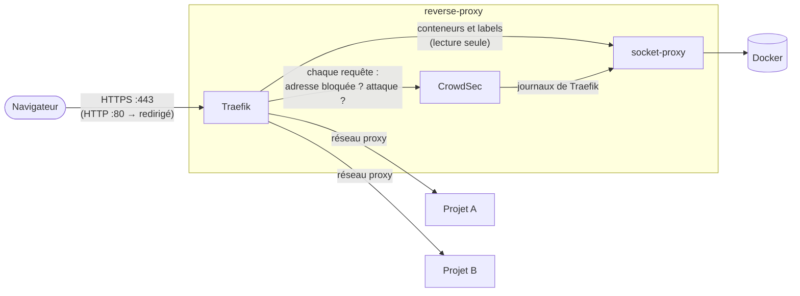

# Architecture

## Vue d'ensemble



Trois conteneurs, définis dans `compose.yaml` :

| Service | Image | Rôle |
|---|---|---|
| `traefik` | `traefik` | reçoit tout le trafic HTTP et HTTPS, gère les certificats et envoie chaque requête au bon projet |
| `crowdsec` | `crowdsecurity/crowdsec` | pare-feu applicatif : bloque les attaques connues et les adresses malveillantes (voir [WAF](waf.md)) |
| `socket-proxy` | `tecnativa/docker-socket-proxy` | donne à Traefik et CrowdSec un accès **en lecture seule** à Docker |

## Comment un projet est trouvé

Traefik ne contient aucune liste de sites. Il interroge Docker, trouve les conteneurs qui
portent le label `traefik.enable: "true"`, et lit leurs autres labels : nom de domaine,
port… Lancer ou arrêter un projet suffit à l'ajouter ou à le retirer, sans redémarrer
Traefik. Voir [Brancher un projet](projets.md).

## Réseaux

| Réseau | Qui | Pourquoi |
|---|---|---|
| `proxy` | Traefik et tous les projets exposés | Traefik joint les projets par ce réseau. Il est **externe** : créé une fois par `make app@start`, il survit aux redémarrages et chaque projet le rejoint |
| `socket` | Traefik, CrowdSec, socket-proxy | **interne** : sans accès à Internet ni aux projets ; seul chemin vers l'API Docker |
| `default` | CrowdSec | accès à Internet, pour télécharger les règles et la liste communautaire d'adresses malveillantes |

## Sécurité

- **Socket proxy.** Le socket Docker donne le contrôle complet de la machine. Il n'est monté
  que dans `socket-proxy`, qui n'autorise que la lecture des conteneurs (`CONTAINERS=1`,
  `INFO=1`, `POST=0`). Si Traefik était compromis, il ne pourrait ni lancer ni modifier de
  conteneur.
- **`no-new-privileges`** sur Traefik et CrowdSec : un processus ne peut pas gagner de droits.
- **Rien n'est exposé par défaut** (`exposedByDefault=false`) : un conteneur n'est publié que
  s'il le demande avec ses labels.
- **En-têtes ambigus supprimés** (`aliasHeadersStrategy=delete`) : un en-tête comme
  `X.Auth.User`, que PHP lit comme `X-Auth-User`, ne peut pas se faire passer pour un
  en-tête ajouté par le proxy.
- **WAF devant chaque site** : le middleware CrowdSec est appliqué au point d'entrée HTTPS,
  donc à tous les projets, sans qu'ils aient à le déclarer.
- **Clé CrowdSec** : générée sur la machine (`secrets/crowdsec-bouncer.key`, droits `600`),
  jamais versionnée, transmise aux conteneurs comme secret Docker.

## Local et prod

La configuration est découpée en un fichier commun et un fichier par environnement :

```bash
docker compose -f compose.yaml -f compose.$APP_ENV.yaml …
```

| | local (`compose.local.yaml`) | prod (`compose.prod.yaml`) |
|---|---|---|
| Ports | `127.0.0.1:80` et `:443` : joignables depuis le poste seulement | `80` et `443` ouverts sur Internet |
| Certificats | un certificat `*.dev.localhost` généré par mkcert | un certificat Let's Encrypt par site, obtenu et renouvelé automatiquement |
| Tableau de bord | https://traefik.dev.localhost | désactivé |
| Middlewares sur chaque site | `crowdsec` | `crowdsec`, `security-headers` |
| En-têtes de sécurité | — | HSTS (1 an), `nosniff`, interdiction des iframes, `Referrer-Policy` |
| TLS | par défaut | TLS 1.2 minimum, refus des noms inconnus (`sniStrict`) |
| Journaux | `DEBUG` | `INFO` |

Dans les deux cas, HTTP est redirigé vers HTTPS et les journaux d'accès sont activés
(CrowdSec les analyse).

## Configuration dynamique

Traefik lit le dossier `/etc/traefik/dynamic` du conteneur, sous-dossiers compris. Deux
dossiers du projet y sont montés côte à côte :

| Dossier du projet | Monté sur | Contenu |
|---|---|---|
| `traefik/common/dynamic/` | `/etc/traefik/dynamic/common` | `crowdsec.yml` : le middleware WAF |
| `traefik/local/dynamic/` ou `traefik/prod/dynamic/` | `/etc/traefik/dynamic/env` | `tls.yml` (certificat local) ou `middlewares.yml` (en-têtes de sécurité, options TLS) |

Traefik lit bien les sous-dossiers, mais ne surveille pas leurs modifications : après avoir
modifié ou ajouté un fichier, lancer `make app@restart`.

## Données et fichiers générés

Rien de ce qui est propre à une machine n'est versionné :

| Fichier ou volume | Créé par | Contenu |
|---|---|---|
| `.env` | `app@install` | réglages de la machine (`APP_ENV`, `ACME_EMAIL`) |
| `secrets/crowdsec-bouncer.key` | `app@install` (`waf@key`) | clé partagée entre Traefik et CrowdSec |
| `certs/local.pem`, `certs/local-key.pem` | `cert@create` | certificat local |
| `certs/acme.json` | Traefik, en prod | compte et certificats Let's Encrypt (droits `600` obligatoires) |
| `.tools/bin/` | `app@install` | mkcert, gitleaks, shellcheck, dans leur version fixée |
| volumes `crowdsec-config`, `crowdsec-data` | Docker | configuration, règles et décisions de CrowdSec |

`make app@stop` conserve les volumes : les adresses bloquées le restent après un redémarrage.

## Arborescence

```
.
├── Makefile                  # liste les commandes, inclut .make/*.mk
├── .make/
│   ├── <domaine>.mk          # déclare les commandes d'un domaine
│   └── scripts/
│       ├── lib.sh            # fonctions communes à tous les scripts
│       └── <domaine>/<action>.sh
├── compose.yaml              # base commune
├── compose.local.yaml        # surcouche locale
├── compose.prod.yaml         # surcouche prod
├── .env.example              # modèle du .env
├── traefik/
│   ├── common/dynamic/       # configuration Traefik commune
│   ├── local/dynamic/
│   └── prod/dynamic/
├── crowdsec/acquis.d/        # ce que CrowdSec analyse
├── certs/                    # certificats (non versionnés)
├── .githooks/                # hooks Git (voir Développement)
├── .github/                  # GitHub Actions et Dependabot
└── docs/
```
