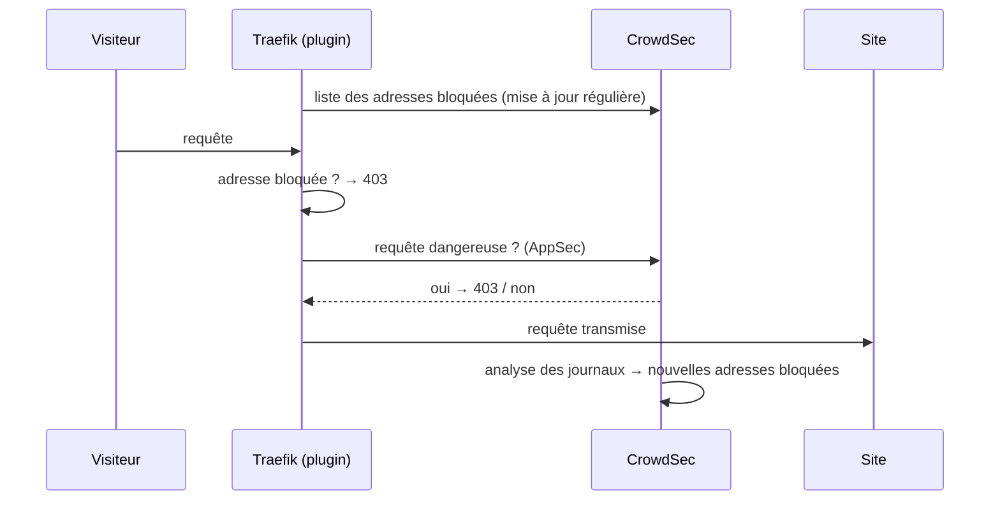

# WAF (pare-feu applicatif)

Tous les sites servis par le reverse proxy sont protégés par
[CrowdSec](https://www.crowdsec.net/), sans configuration de leur côté.

## Ce qui est bloqué

CrowdSec protège à deux niveaux.

**Chaque requête est inspectée avant d'atteindre le site** (composant AppSec). Les
attaques connues sont refusées avec une erreur `403` :

- accès aux fichiers sensibles : `/.env`, `/.git/config`, sauvegardes… ;
- exploitation de failles connues de logiciels courants (WordPress, frameworks PHP,
  serveurs d'applications…), corrigées « virtuellement » même si le site n'est pas à jour
  (collection `appsec-virtual-patching`) ;
- attaques génériques : injection SQL, inclusion de fichiers, injection de commandes…
  (collection `appsec-generic-rules`).

**Les comportements suspects sont repérés dans les journaux de Traefik** (collection
`crowdsecurity/traefik`) : balayage de pages à la recherche de failles, essais de mots de
passe en série, robots agressifs… L'adresse en cause est alors **bloquée sur tous les
sites**, pour quelques heures.

S'y ajoute la **liste communautaire** : les adresses signalées par les autres
utilisateurs de CrowdSec sont bloquées par avance.

## Fonctionnement



- Le plugin Traefik ([crowdsec-bouncer-traefik-plugin](https://github.com/maxlerebourg/crowdsec-bouncer-traefik-plugin))
  est déclaré comme middleware dans `traefik/common/dynamic/crowdsec.yml` et appliqué au
  point d'entrée HTTPS, donc à tous les sites.
- Il garde en mémoire la liste des adresses bloquées et la met à jour régulièrement (mode
  *stream*) : vérifier une adresse ne coûte pas d'appel à CrowdSec.
- CrowdSec lit les journaux de Traefik par le socket proxy (`crowdsec/acquis.d/traefik.yaml`)
  et reçoit les requêtes à inspecter sur son port AppSec (`crowdsec/acquis.d/appsec.yaml`).
- Traefik et CrowdSec se reconnaissent grâce à la clé `secrets/crowdsec-bouncer.key`,
  générée par `make app@install`.

### Si CrowdSec ne répond pas

Le WAF est réglé pour **laisser passer** le trafic si CrowdSec est arrêté, en cours de
démarrage ou injoignable : les sites restent en ligne, sans protection, plutôt que d'être
tous bloqués. C'est pourquoi `make waf@test` existe : vérifier que la protection est
réellement active, pas seulement que les sites répondent.

## Vérifier

```bash
make waf@test                              # en local
make waf@test SITE=monsite.example.com     # en prod
```

La commande demande `/.env` au site et attend un `403`. Un autre code signifie que la
requête n'a pas été bloquée : voir le [dépannage](depannage.md#le-waf-ne-bloque-pas).

```bash
make waf@metrics
```

| Tableau | À lire |
|---|---|
| *Acquisition Metrics* | lignes de journal lues par CrowdSec ; `appsec` compte les requêtes inspectées |
| *Appsec Metrics* | requêtes inspectées (`Processed`) et bloquées (`Blocked`) |
| *Appsec Rules Metrics* | quelles règles ont bloqué, et combien de fois |
| *Scenario Metrics* | comportements suspects détectés dans les journaux |

Dans *Acquisition Metrics*, la ligne `docker:/reverse-proxy-traefik-1` compte aussi les
journaux techniques de Traefik : un grand nombre de *Lines unparsed* est normal, seules
les lignes du journal d'accès sont analysées. Les requêtes vers le tableau de bord ne
figurent pas dans ce journal.

## Adresses bloquées

```bash
make waf@decisions                  # qui est bloqué, pourquoi, pour combien de temps
make waf@unban IP=198.51.100.7      # débloquer une adresse
```

Un blocage peut prendre jusqu'à une minute pour être appliqué ou levé : le temps que le
plugin récupère la nouvelle liste.

En local, les requêtes viennent d'adresses privées, que CrowdSec ne bloque jamais : les
attaques sont refusées une à une (`403`), mais le poste n'est jamais banni.

## Aller plus loin

Toutes les commandes de CrowdSec (`cscli`) sont disponibles dans son conteneur :

```bash
docker compose exec crowdsec cscli --help
docker compose exec crowdsec cscli alerts list      # historique des détections
docker compose exec crowdsec cscli collections list # règles installées
```

Les données de CrowdSec (configuration, règles téléchargées, décisions) sont dans les
volumes `crowdsec-config` et `crowdsec-data` : elles survivent à `make app@stop`.

La clé `secrets/crowdsec-bouncer.key` ne doit pas être régénérée seule : CrowdSec
l'enregistre à son premier démarrage, et une nouvelle clé ne correspondrait plus (voir le
[dépannage](depannage.md#changer-la-clé-crowdsec)).
